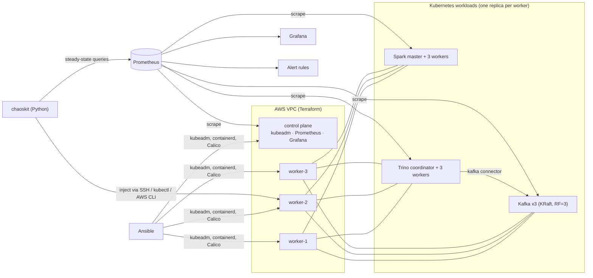

# Distributed Infrastructure Reliability & Observability Platform

A 4-node Kubernetes cluster running a distributed data stack (**Kafka**, **Spark**, **Trino**), provisioned end-to-end with **Terraform** and **Ansible**, monitored with **Prometheus/Grafana**, and stress-tested with a Python failure-injection toolkit that measures how long the system takes to detect and recover from each fault.


## Architecture



| Layer | Tooling | Where |
|---|---|---|
| Infrastructure | Terraform: VPC, subnet, security group, 1 control-plane + 3 worker EC2 instances; writes the Ansible inventory | [`terraform/`](terraform) |
| Configuration | Ansible: kernel params, swap off, containerd, kubeadm init/join, Calico CNI, chaos tooling | [`ansible/`](ansible) |
| Workloads | Strimzi Kafka (3 brokers, `min.insync.replicas=2`), Spark standalone, Trino (Helm), plus steady load generators | [`k8s/`](k8s) |
| Observability | kube-prometheus-stack, JMX/Prometheus exporters, 12-metric Grafana dashboard, alert rules | [`monitoring/`](monitoring) |
| Reliability testing | `chaoskit`: 12 failure scenarios, recovery-time measurement, auto-generated RCA reports | [`chaos/`](chaos) |
| Operations | Runbooks per failure class, linked from every alert | [`docs/runbooks/`](docs/runbooks) |

## Monitored metrics (12)

The dashboard is generated from code ([`scripts/build_dashboard.py`](scripts/build_dashboard.py)), so the panels, alert rules and chaos steady-state checks use the same queries.

| # | Metric | Source |
|---|---|---|
| 1 | Node CPU utilisation | node-exporter |
| 2 | Node memory utilisation | node-exporter |
| 3 | Root disk usage | node-exporter |
| 4 | Network receive throughput | node-exporter |
| 5 | Ready nodes | kube-state-metrics |
| 6 | Pod restarts (kafka/spark/trino) | kube-state-metrics |
| 7 | Kafka under-replicated partitions | Kafka JMX exporter |
| 8 | Kafka consumer lag | Kafka Exporter |
| 9 | Kafka messages in/s | Kafka JMX exporter |
| 10 | Spark alive workers | Spark PrometheusServlet |
| 11 | Spark running / waiting apps | Spark PrometheusServlet |
| 12 | Trino active nodes & running queries | Trino JMX exporter |

## Failure scenarios (12)

Defined in [`chaos/scenarios.yaml`](chaos/scenarios.yaml). Each run checks the steady state first, injects the fault, records **time-to-detect**, removes the fault, and records **time-to-recover** and **MTTR**. Network and disk faults also install a dead-man switch on the node, so they are removed even if the runner crashes.

| ID | Scenario | Category | Expected detection |
|---|---|---|---|
| S01 | Worker EC2 instance stopped | node | NodeNotReady, Kafka URP, Spark workers |
| S02 | kubelet stopped | node | NodeNotReady |
| S03 | containerd restarted | node | Pod restarts |
| S04 | Node drained (maintenance) | node | Kafka URP |
| S05 | Network partition (iptables) | network | NodeNotReady, Kafka URP |
| S06 | 250 ms latency (tc netem) | network | Consumer lag |
| S07 | 20% packet loss | network | Kafka URP, consumer lag |
| S08 | CPU saturation (stress-ng) | resource | NodeHighCPU |
| S09 | Memory pressure | resource | NodeMemoryPressure |
| S10 | Disk fill | resource | NodeDiskAlmostFull |
| S11 | Kafka broker pod killed | service | Kafka URP |
| S12 | Spark + Trino worker pods killed | service | Spark/Trino workers missing |

Each run writes `chaos/results/<timestamp>-<id>.md`: measurements, a state-change timeline, alerting gaps (expected alerts that did not fire), a root-cause-analysis section and the Kubernetes events from the run window. `chaos/results/SUMMARY.md` collects the latest run of every scenario.

## Quick start

Requirements: Terraform ≥ 1.5, Ansible, kubectl, Helm, AWS CLI with credentials, Python ≥ 3.10.

```bash
# 1. Infrastructure (4 EC2 nodes + network)
cp terraform/terraform.tfvars.example terraform/terraform.tfvars   # set admin_cidr to your IP
make infra

# 2. Kubernetes cluster
make cluster                         # writes ./kubeconfig

# 3. Data stack + monitoring
export GRAFANA_ADMIN_PASSWORD='choose-one'
make stack                           # Grafana on :30300, Prometheus on :30090

# 4. Failure injection
pip install -r chaos/requirements.txt
make chaos-dry                       # review every command first
make chaos-all                       # or: cd chaos && python -m chaoskit run S05 --prometheus http://<cp-ip>:30090

# 5. Clean up
make destroy
```

## Development

```bash
make test    # chaoskit unit tests (fake clock + scripted Prometheus, no cluster needed)
make lint    # yamllint, ruff, terraform fmt
```

CI ([`.github/workflows/ci.yml`](.github/workflows/ci.yml)) runs `terraform validate`, `ansible-lint`, `yamllint`, `ruff` and `pytest` on every push.

## Design notes

- **One replica per node.** Kafka brokers use required pod anti-affinity and Spark/Trino workers preferred anti-affinity, so a single node failure removes exactly one replica of each service, which makes recovery behaviour predictable to measure.
- **Kafka durability.** RF=3 with `min.insync.replicas=2` and `acks=all` keeps writes available when one broker is lost; `unclean.leader.election.enable=false` keeps data correct.
- **Missing metric = unhealthy.** If a steady-state query returns nothing (e.g. the exporter is down), chaoskit treats it as a failure instead of passing silently.
- **Node-local storage trade-off.** `local-path` volumes keep the setup cheap, but a drained or lost node takes its Kafka replica with it (see the [S04 runbook](docs/runbooks/node-failures.md#s04-node-drain)).
